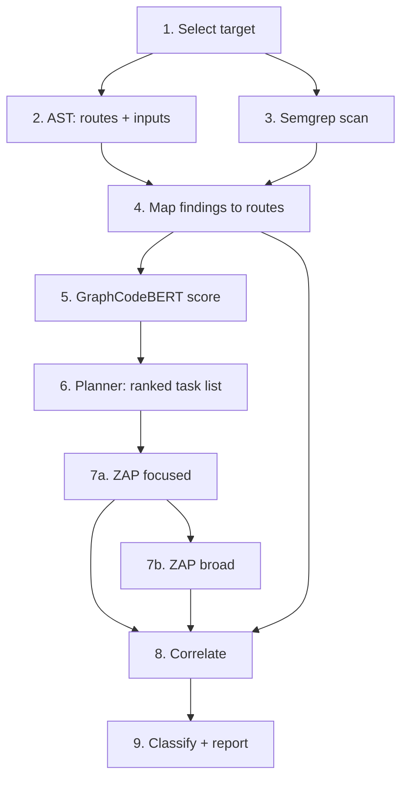

# P06 — SAST/DAST Correlation Engine (MVP Plan)

---

## 0. STRICT ADHERENCE DIRECTIVE (READ FIRST)

**This document is the single source of truth. Whoever implements it (developer or AI assistant) MUST follow it exactly.**

1. **Follow the build order in §10.** Do not start a phase until the previous phase's *Done when* checks pass.
2. **Do not add scope.** Anything listed under "Out of scope" (§2) must not be built, stubbed, or "prepared for".
3. **Do not change contracts (§6), file names (§9), labels (§8), or the correlation rules (§7.8) on your own.** If a change seems necessary, stop, state the conflict, and update this plan first.
4. **Do not weaken the strict correlation rules** to get more matches. A missing match is acceptable; a false match is not.
5. **Never report success for something that did not run.** Failed, skipped, timed-out, and untested items stay visible and distinct.
6. **GraphCodeBERT only affects ranking.** It must never create a route mapping, hide a finding, or mark anything Confirmed.
7. **One target per scan.** Never mix data, requests, or findings between Flask and Juice Shop.
8. **Do not guess.** Unclear routes or mappings are marked `unresolved` / `ambiguous`, never filled in.
9. **Do not apply code changes to target apps automatically.** Fix output is advice text only.
10. **If anything is ambiguous or missing in this plan, ask before inventing behaviour.** Record the answer in this file.
11. **Report deviations.** At the end of each phase, list any deviation from this plan (ideally none).

---

## 1. Goal

Scan one web app at a time (**Flask demo** or **OWASP Juice Shop**) with a single pipeline:

1. Find routes and request inputs in the source code (AST).
2. Find suspicious code (Semgrep).
3. Link each Semgrep finding to a route.
4. Rank findings, including a GraphCodeBERT score.
5. Run ZAP on the highest-ranked routes first, then on the rest.
6. Correlate static and runtime results and label them.
7. Write a JSON + HTML report.

**What the project must prove:** ranked scanning finds confirmed vulnerabilities sooner than a default-order ZAP scan, without losing coverage or accuracy.

---

## 2. MVP Scope

| In scope | Out of scope (do not build) |
|---|---|
| CLI that runs a scan and writes a report | Web frontend, live progress events/SSE |
| Flask first, then Juice Shop | Any third target |
| AST + Semgrep + route mapping | Database / persistent storage layer |
| GraphCodeBERT as one scoring input | Fine-tuning or training any model |
| ZAP focused phase, then broad phase | Parallel scans, multi-user, auth for the engine itself |
| Strict correlation + 3 labels | Auto-generated patches, apply, approval, re-test |
| Plain-text fix advice per finding | LLM-generated code patches |
| Evaluation against ground truth | Dashboards, scheduling, CI integration |

---

## 3. Tech Stack and Prerequisites

| Item | Choice | Notes |
|---|---|---|
| Language | Python 3.11+ | Engine and CLI |
| Python AST (Flask) | built-in `ast` module | |
| JS/TS AST (Juice Shop) | `tree-sitter` with JavaScript + TypeScript grammars | Pin versions |
| SAST | Semgrep (pinned version) | Taint-mode rules + custom rules |
| DAST | OWASP ZAP (pinned Docker image) via ZAP API | |
| Model | `microsoft/graphcodebert-base` (pinned revision) via `transformers` + `torch` | CPU is acceptable; set token limit (512) |
| Containers | Docker + docker-compose | One network per target |
| Config | YAML (`pyyaml`) | |
| Data models | `pydantic` | |
| Tests | `pytest` | |

**Before Phase 1:** record exact versions of Semgrep, ZAP image, Juice Shop release, Flask, and the model revision in `README.md`. These are written into every scan record.

---

## 4. Pipeline Overview



Each step reads the previous steps' outputs and writes to the in-memory scan state. The final report is the only file output (plus an optional JSON dump of intermediate state under `runs/<scan_id>/` for debugging).

---

## 5. Step-by-Step Specification

### Step 1 — Select and prepare target
- **Input:** target name from CLI (`flask-demo` or `juice-shop`).
- **Actions:** load `targets/<name>/target.yaml`; create `scan_id`; verify source path exists and runtime URL responds; verify the URL belongs to this target.
- **Output:** `TargetProfile` + scan context.
- **Fails if:** config missing, source path missing, or runtime unreachable. Abort with a clear error.

### Step 2 — AST route discovery
- **Flask adapter (`ast_flask.py`):** route decorators (`@app.route`, `@bp.route`, `@app.get/post/...`), blueprint prefixes, paths, methods, handler function, helper functions called by the handler (same file, one level of call resolution minimum), request reads (`request.args`, `request.form`, `request.json`, `request.values`, path params).
- **Express adapter (`ast_express.py`):** `app.get/post/put/delete/use`, `router.*`, mounted routers and prefixes, handler functions (inline or named), helper calls, `req.params`, `req.query`, `req.body`.
- **Both:** normalize path params to `/{name}`; record file, start line, end line of each handler scope; set `unresolved=true` for dynamic or non-literal routes.
- **Output:** list of `RouteNode`.

### Step 3 — Semgrep SAST
- Run rules from `config/semgrep/` against the target's source path only.
- Capture: rule ID, CWE (from rule metadata), severity, file, line/column range, matched code, message.
- If Semgrep exits with an error, record `semgrep_status=failed` and continue only to report that SAST did not run. Do **not** treat as clean.
- **Output:** list of `UnifiedFinding` (source_tool = `semgrep`).

### Step 4 — Map findings to routes
For each Semgrep finding:
1. If the finding line is inside a handler scope → `mapped` to that route.
2. Else if it is inside a helper function called by exactly one route → `mapped` to that route.
3. Else if the helper is called by multiple routes, or scope relationship is uncertain → `ambiguous` (store candidate routes).
4. Else → `unmapped`.
- Attach route path, method, and the request inputs read in that scope.
- Never use CWE or text similarity to decide mapping.

### Step 5 — GraphCodeBERT score
- **Input per candidate (`mapped` or `ambiguous` finding):** handler code + surrounding code of the finding (clip to the 512-token limit; cut lowest-relevance lines first).
- **Method:** encode the snippet and a short vulnerability-class description (from `config/graphcodebert/class_descriptions.yaml`, e.g. "SQL injection: user input concatenated into a SQL query"); score = cosine similarity, rescaled to 0..1.
- **Output:** `CodeContextResult` with score, model name, model revision, preprocessing version, `status` (`ok`, `failed`, `timeout`, `skipped`).
- **On failure:** score = 0, status recorded, scan continues with AST + Semgrep only. The report must say the model stage failed.
- **Limits:** advisory only (see §0 rule 6).

### Step 6 — Plan ZAP tasks
Create one `ScanTask` per (route, method, input, ZAP check) for mapped/ambiguous findings, using `config/zap/category_map.yaml` (vulnerability category → ZAP scan rule IDs). Skip checks not supported by the installed ZAP version.

```
priority = w_map * mapping_quality   # mapped=1.0, ambiguous=0.4, unmapped=0.0
         + w_sev * severity          # low=0.25, medium=0.5, high=0.75, critical=1.0
         + w_gcb * graphcodebert     # 0..1 (0 if model failed)
         + w_inp * has_input         # 1 if route reads a request input else 0
```

Default weights in `config/scan_profile.yaml`: `w_map=0.4, w_sev=0.3, w_gcb=0.2, w_inp=0.1`.

- Each task stores `reason` (text) listing the values that produced its priority.
- Tasks with `unmapped` findings and all other discovered routes go to the **broad queue** (no priority).
- **Output:** ordered focused queue + broad queue.

### Step 7 — Run ZAP
**Setup (once per scan):**
1. Reset target app state (restart the container or reload seed data).
2. Create ZAP context limited to the target's runtime URL (nothing outside it is allowed).
3. Seed ZAP with every AST route as a concrete request (use sample values for path params and inputs; needed for the Juice Shop SPA).
4. For routes needing login: authenticate (Juice Shop: register/login via API, send JWT as header). Routes that still need auth after this are `needs_auth`.

**Phase A — Focused:** run the focused queue in priority order. Each task runs an active scan restricted to the task's URL and ZAP rules. The input name is stored for correlation (ZAP scans per URL/policy, not per parameter). Stop Phase A when the queue is finished or its time share is used.

**Phase B — Broad:** with remaining budget, run the default/active policy on other discovered routes. Do not repeat completed tasks.

**Budget (from `scan_profile.yaml`):** `total_minutes: 30`, `focused_share: 0.6`, `per_task_timeout_seconds: 120`, `max_retries: 1`.

**Task states:** `queued → running → completed | failed | skipped | needs_auth | unreachable`.
Only `completed` counts as tested. Everything else is reported as **untested**, never "safe".

- Alerts are parsed into `UnifiedFinding` (source_tool = `zap`) and passed to correlation as they arrive.

### Step 8 — Correlate
See §7.8 for the exact rules. Runs incrementally per new alert, then a final pass at scan end.

### Step 9 — Classify and report
- Assign a label to every finding (§8).
- Write `reports/<scan_id>/report.json` and `report.html`.
- Report contents: scan metadata (versions, model status, budget used), summary counts, per-finding table, untested task list, failed task list, deviations/warnings.

---

## 6. Data Contracts (`engine/models.py`)

All models are `pydantic` classes. Every record includes `scan_id` and `target_id`.

| Contract | Fields |
|---|---|
| `TargetProfile` | `target_id`, `app_type` (`flask`/`express`), `source_path`, `runtime_url`, `language_adapter` |
| `RouteNode` | `route_id`, `target_id`, `path` (normalized), `methods[]`, `handler`, `file`, `start_line`, `end_line`, `helper_scopes[]` (file, start, end), `inputs[]` (name, location: query/body/path/header), `unresolved` (bool) |
| `UnifiedFinding` | `finding_id`, `target_id`, `source_tool` (`semgrep`/`zap`), `tool_rule_id`, `cwe`, `severity`, `file`, `line`, `route`, `method`, `parameter`, `mapping_status` (`mapped`/`ambiguous`/`unmapped`/`n/a`), `candidate_routes[]`, `evidence` (matched code or request/response excerpt), `raw_ref` |
| `CodeContextResult` | `finding_id`, `route_id`, `score`, `model_name`, `model_revision`, `preprocess_version`, `status`, `error` |
| `ScanTask` | `task_id`, `target_id`, `route`, `method`, `input`, `zap_rule_ids[]`, `queue` (`focused`/`broad`), `priority`, `reason`, `status`, `error`, `started_at`, `ended_at` |
| `CorrelationResult` | `sast_finding_id`, `dast_finding_id`, `criteria` (map of rule → pass/fail/unknown), `label`, `rationale` |

Keep original tool IDs and raw evidence references on every finding.

---

## 7. Configuration Files

### 7.1 `targets/<name>/target.yaml`
```yaml
target_id: flask-demo
app_type: flask
source_path: ./app
runtime_url: http://flask-demo:5000
language_adapter: ast_flask
```

### 7.2 `config/scan_profile.yaml`
```yaml
total_minutes: 30
focused_share: 0.6
per_task_timeout_seconds: 120
max_retries: 1
weights: {map: 0.4, severity: 0.3, graphcodebert: 0.2, has_input: 0.1}
```

### 7.3 `config/cwe_map.yaml` (starter)
```yaml
families:
  sql_injection: [89, 564]
  xss: [79, 80]
  path_traversal: [22, 23, 36]
  command_injection: [77, 78]
  ssrf: [918]
  open_redirect: [601]
  xxe: [611]
  code_injection: [94, 95]
```
Two CWEs are compatible only if they are equal or in the same family.

### 7.4 `config/zap/category_map.yaml`
Maps each family above to the ZAP active-scan rule IDs that exist in the pinned ZAP version. Fill by checking the installed ZAP's rule list; do not copy IDs from memory.

### 7.5 `config/graphcodebert/class_descriptions.yaml`
One short sentence per vulnerability family used for the similarity score.

### 7.6 Docker and isolation
`docker-compose.yml` defines: `engine`, `zap`, and each target on **its own network**. Only the selected target's network is attached to `zap` for that scan. ZAP's context allows only that target's URL.

### 7.7 CLI
```bash
python -m engine.cli scan --target flask-demo --profile config/scan_profile.yaml
python -m engine.cli scan --target juice-shop --mode baseline     # default-order ZAP, no planner
python -m engine.cli scan --target juice-shop --no-gcb            # planner without GraphCodeBERT
python -m engine.cli eval --target flask-demo                     # compare runs vs ground truth
```

### 7.8 Correlation rules (strict, ALL must pass)
A SAST finding S and a DAST alert D are a **strong match** only if:

1. `S.target_id == D.target_id`.
2. CWE of S and D are equal or in the same family (`cwe_map.yaml`).
3. Normalized route of S equals route of D.
4. S's line lies inside the mapped route's handler or helper scope.
5. D's attacked parameter equals one of the route's inputs read near S (or is the same as S's `parameter`).
6. HTTP method equal when both are known (unknown does not fail, but is recorded in `criteria`).

Additional rules:
- S must have `mapping_status=mapped` to be eligible. `ambiguous` S can never be Confirmed.
- One DAST alert matches at most one SAST finding; one SAST finding may match several alerts but is counted once.
- If several S compete for one D, pick the one with the narrowest scope; if still tied, leave unmatched and note the tie.
- Store the result of every criterion in `CorrelationResult.criteria`.

---

## 8. Result Labels

| Label | Meaning |
|---|---|
| **Confirmed** | SAST and DAST satisfy all rules in §7.8 |
| **Code only** | SAST finding with no matching alert; also state whether its route/rule was tested (`tested` / `untested` / `failed`) |
| **Runtime only** | ZAP alert with no matching SAST finding |

Additional report sections (not labels): **Untested tasks**, **Failed tasks**, **Model stage status**.

---

## 9. Repository Structure

```text
p06-engine/
+-- README.md                  # Setup, pinned versions, usage
+-- plan.md                    # THIS FILE
+-- pyproject.toml
+-- docker-compose.yml
+-- .env.example
+-- .gitignore
|
+-- engine/
|   +-- cli.py                 # Entry point
|   +-- pipeline.py            # Runs steps 1-9 in order (no parsing/ZAP logic here)
|   +-- models.py              # Contracts from section 6
|   +-- targets.py             # Load/validate target profile
|   +-- ast_flask.py           # Flask route + input extraction
|   +-- ast_express.py         # Express route + input extraction
|   +-- semgrep_runner.py      # Run + parse Semgrep
|   +-- route_matcher.py       # Finding -> route mapping
|   +-- gcb.py                 # GraphCodeBERT: context, inference, score
|   +-- planner.py             # Priority score + queues
|   +-- zap_runner.py          # ZAP client, setup, focused + broad, alert parser
|   +-- correlate.py           # Normalize, correlate, classify
|   +-- report.py              # JSON + HTML report, fix advice
|
+-- targets/
|   +-- flask-demo/            # app/, Dockerfile, target.yaml
|   +-- juice-shop/            # pinned version, Dockerfile, target.yaml, README.md
|
+-- config/
|   +-- semgrep/               # Rules
|   +-- zap/                   # Policy, category_map.yaml
|   +-- graphcodebert/         # class_descriptions.yaml
|   +-- cwe_map.yaml
|   +-- scan_profile.yaml
|
+-- ground_truth/              # flask-demo.yaml, juice-shop.yaml (known vulnerabilities)
+-- tests/                     # unit/, e2e/, fixtures/
+-- runs/                      # Debug dumps (git-ignored)
+-- reports/                   # Output reports (git-ignored)
+-- docs/                      # adding-a-target.md, evaluation-results.md
```

**Design rules:**
- Flask and Express parsers stay separate and emit the same `RouteNode`.
- Planner and correlation only use internal models, never raw Semgrep/ZAP payloads.
- `pipeline.py` only coordinates; it contains no parsing, model, ZAP, or matching logic.
- Every finding stores its evidence and the reason for its status.
- Secrets, logs, model caches, and reports stay out of Git.

---

## 10. Build Order (follow strictly)

| Phase | Work | Done when (checks) |
|---|---|---|
| **1. Foundation** | `models.py`, `targets.py`, config files, Flask demo app with seeded vulnerabilities (at least SQLi, XSS, path traversal, command injection, open redirect), `ground_truth/flask-demo.yaml`, docker-compose | `cli scan --target flask-demo` loads the profile, checks source and runtime, and exits cleanly; contracts validate in unit tests |
| **2. Static analysis (Flask)** | `ast_flask.py`, `semgrep_runner.py`, `route_matcher.py` | Every seeded route is discovered; Semgrep findings appear as `UnifiedFinding`; mapping states `mapped/ambiguous/unmapped` all occur in tests; unit tests pass |
| **3. ZAP runner** | `zap_runner.py`: setup, seeding, **baseline default-order mode**, then focused and broad phases with task states and budget | Baseline run completes; focused/broad run completes; every task has a final status; untested list is produced |
| **4. Correlation + report** | `correlate.py`, `report.py` | Full Flask report with Confirmed / Code only / Runtime only; every Confirmed has all criteria recorded; no ZAP alert used twice |
| **5. GraphCodeBERT + planner** | `gcb.py`, `planner.py` | Model status recorded on every run; `--no-gcb` and with-GCB runs both work; forced model failure produces a clear degraded-mode note in the report; every task has a reason |
| **6. Juice Shop** | `ast_express.py`, Juice Shop target, custom Semgrep rules, login + route seeding | Same CLI and pipeline work on Juice Shop with no pipeline code changes; auth-required routes show `needs_auth` or are tested after login |
| **7. Evaluation** | `cli eval`, three-run comparison on both targets | Results table (§11) written to `docs/evaluation-results.md` |
| **8. Polish** | README, `docs/adding-a-target.md`, cleanup | A new person can run both scans from the README alone |

**Phase gate rule:** run the phase's tests and checks, list any deviation from this plan, then continue. Do not skip, merge, or reorder phases.

---

## 11. Evaluation

**Ground truth:** `ground_truth/flask-demo.yaml` (seeded vulnerabilities: route, parameter, CWE) and Juice Shop's built-in challenge list (select the challenges that map to the supported CWE families).

**Three runs per target, same budget, same starting state:**
1. Baseline: default-order ZAP (no planner).
2. Planner without GraphCodeBERT (`--no-gcb`).
3. Planner with GraphCodeBERT.

| Metric | Purpose |
|---|---|
| Time to first Confirmed finding | Prioritization benefit |
| Confirmed findings at 25% and 50% of budget | Prioritization benefit |
| Confirmed findings at end of budget | No coverage lost |
| Correlation precision and recall vs ground truth | Matching accuracy |
| Untested route count | Coverage honesty |
| Total runtime | Cost |

Run each configuration at least 3 times and report the average and range. State plainly if the planner or GraphCodeBERT does **not** help.

---

## 12. Failure Handling

| Problem | Required behaviour |
|---|---|
| Target config invalid / runtime down | Abort before scanning with a clear error |
| AST parse issue | Log affected files; keep only reliable routes; mark others `unresolved` |
| Semgrep fails | Record `failed`; never treat as clean; report says SAST did not run |
| GraphCodeBERT fails or times out | Record status; score 0; plan from AST + Semgrep; report says so |
| ZAP task fails / times out | Keep status + error; not counted as tested; retry at most `max_retries` and record the retry |
| Route needs auth and login failed | `needs_auth`; listed as untested |
| Budget exhausted | Stop scheduling; list remaining tasks as untested |
| No correlation | Keep as Code only / Runtime only; never force a match |

---

## 13. Fix Advice (MVP)

For each Confirmed and Code-only finding, the report shows: likely root cause (one or two sentences), recommended remediation (e.g. parameterized queries, output encoding, path allow-listing), and why it addresses the finding. Use short templates per CWE family in `report.py`. No code is changed in the target apps.

---

## 14. Risks and Mitigations

| Risk | Mitigation |
|---|---|
| Juice Shop is an Angular SPA; spider finds little | Seed ZAP with AST routes; authenticate first |
| Dynamic Express routes hard to resolve | Mark `unresolved`; do not guess |
| Off-the-shelf model adds little value | Keep it advisory; evaluation includes with/without comparison |
| Weights are guesses | Tunable in `scan_profile.yaml`; report results honestly |
| ZAP state drifts between runs | Reset the target and ZAP session before every run |
| Active scan against wrong host | ZAP context allows only the selected target URL; verified in Step 1 |

---

## 15. Success Criteria

- Flask and Juice Shop both run through the same pipeline from the CLI.
- Routes and Semgrep findings are linked, with honest `ambiguous` and `unmapped` states.
- GraphCodeBERT runs on both targets and its status is recorded on every scan.
- Every focused task shows why it was selected; focused tasks run before broad tasks.
- Correlation follows §7.8 exactly, with no forced or reused matches.
- The report separates Confirmed, Code only, Runtime only, untested, and failed.
- The evaluation table in `docs/evaluation-results.md` shows how ranked scanning compares with the default order.
- No item from "Out of scope" (§2) was built, and the final deviation report lists none (or each deviation is documented and approved).
